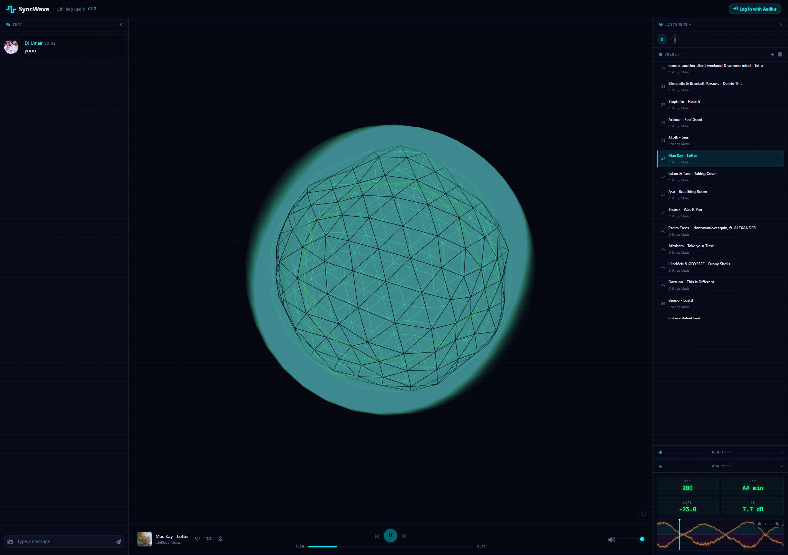
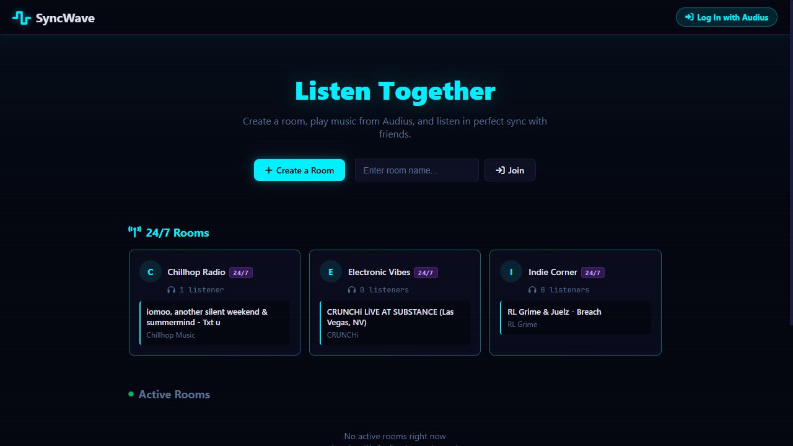
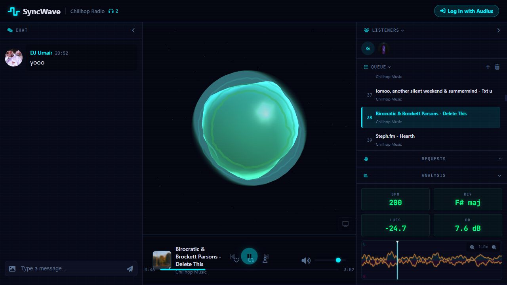
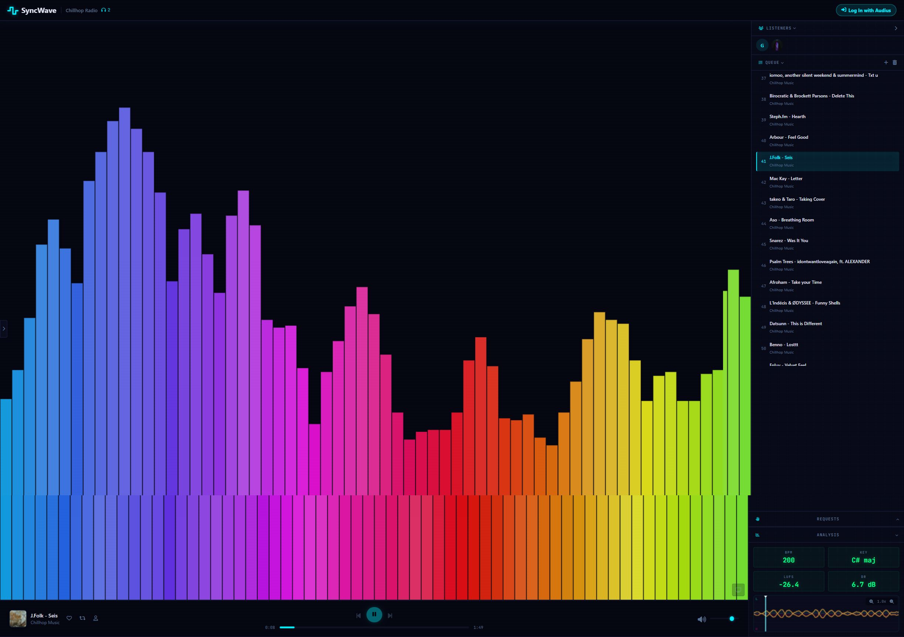

# SyncWave

**Music is better together.** Live listening rooms for the Audius catalog, with
synchronized playback, shared queues, chat, and audio-reactive visualizers.

[**Try the live demo →**](https://syncwaveproject.pages.dev/)
 · [Chillhop Radio](https://syncwaveproject.pages.dev/#/room/247room1)
 · [Deployment guide](docs/cloudflare-deployment.md)




## What you can do

- **Listen in sync.** Hosts broadcast playback state; listeners correct drift.
  Permanent rooms calculate their shared playback position from timestamps, so
  they continue when no host is present.
- **Discover music together.** Search Audius tracks, artists, and playlists;
  manage a host-controlled queue and request songs as a listener.
- **Chat while listening.** Text and KLIPY GIF messages share the live room.
  Signed-in messages are saved in D1 and remain available across visits.
- **See the sound.** Switch between Three.js wireframe and bubble visualizers,
  or 2D bars, wave, and circular modes. Inspect a zoomable stereo waveform and
  browser-side BPM, key, loudness, and dynamic-range estimates.
- **Use your Audius account.** Log in, create your own room, and favorite or
  repost tracks and follow artists through your authorized Audius session.

Visitors can listen without signing in. Room ownership and host-only actions are
checked on the server using verified Audius identity.

## A look inside

### Room discovery



### Bubble visualizer



### 2D visualizer



These are screenshots of the deployed application, rather than design mockups.

## Live showcase

| Room | Queue | Open |
| --- | ---: | --- |
| Chillhop Radio | 128 unique songs from five Chillhop Music playlists | [Listen](https://syncwaveproject.pages.dev/#/room/247room1) |
| Electronic Vibes | 28 songs | [Listen](https://syncwaveproject.pages.dev/#/room/247room2) |
| Indie Corner | 30 songs | [Listen](https://syncwaveproject.pages.dev/#/room/247room3) |

The curated queues and restored chat are persisted in the live database. A fresh
database gets the room schema and starter records; it does not clone the live
showcase data. The retired 140 room is archived from discovery, with its data
retained. Chat has no automatic age-based deletion.

## How it works

| Layer | Technology | Responsibility |
| --- | --- | --- |
| Browser | Vanilla JavaScript, HTML/CSS, Three.js, Web Audio | Player, visualizers, waveform, room UI |
| App server | Cloudflare Workers | Public assets, verified identity, fixed database operations, Audius and KLIPY proxies |
| Live rooms | SQLite-backed Durable Objects and WebSockets | Presence, chat delivery, host commands and room isolation |
| Storage | Cloudflare D1 | Queues, playlists, room state and chat history |
| Public address | Cloudflare Pages service binding | `syncwaveproject.pages.dev` forwards to the same Worker and database |

The Pages gateway is deployed once and forwards requests to the current Worker.
Normal app updates only need a Worker deployment; no second frontend build or
separate copy of the database is required.

## Run locally

Use Node.js **22 or newer** (CI uses Node 24):

```sh
npm ci
```

Copy `.env.example` to `.env` and `.dev.vars.example` to `.dev.vars`, then fill in:

| Variable | `.env` / Cloudflare build | `.dev.vars` / Worker runtime |
| --- | --- | --- |
| `AUDIUS_API_KEY` | Public browser key | Same key, stored as a runtime secret |
| `AUDIUS_BEARER_TOKEN` | Never | Audius backend bearer token |
| `KLIPY_API_KEY` | Never | KLIPY GIF API key |

Get Audius credentials from [Audius developer settings](https://audius.co/settings)
and a KLIPY key from the [KLIPY developer portal](https://klipy.com/developers).
The GIF picker uses KLIPY's Tenor-compatible API and includes its attribution.
No Tenor, Supabase, or Netlify credentials are required.

```sh
npm run db:local
npm run dev
```

Open the localhost URL printed by Wrangler. Browser autoplay rules require a
click on Play when entering a room.

## Deploy

The [deployment guide](docs/cloudflare-deployment.md) covers Workers Builds,
runtime secrets, the Pages address, and Audius origin configuration.

```sh
npx wrangler login
npm test
npm run check:deploy
npm run deploy
```

`npm run deploy` builds the public assets, creates or reuses D1 when needed,
applies pending migrations, and publishes the Worker. Secrets are supplied at
runtime and excluded from the public build. Use `npm run deploy:pages` only when
changing the Pages gateway itself.

For another Cloudflare account, update `account_id` in `wrangler.jsonc` and
remove its existing `database_id` before provisioning your own database.

## Checks and operations

`npm test` covers real D1 SQL and separate WebSocket clients in Cloudflare's local
runtime, including persistence, reconnects, identity and ownership enforcement,
room isolation, HTML escaping, GIF request validation, and secret-free builds.
The GIF provider tests use mocked upstream responses; live GIF search also
requires a valid, activated KLIPY key.

`/api/health` checks database availability. `npx wrangler tail` shows Worker errors.
The UI distinguishes expired logins, denied operations, database failures, request
limits, and live-connection interruptions. Read [Cloudflare's platform limits](https://developers.cloudflare.com/workers/platform/limits/)
before using the demo as a high-traffic service.

## Branches

- **`main`** — the canonical Cloudflare application and portfolio documentation.
- **`cloudflare`** — the existing Cloudflare deployment branch, retained during
  the production-branch transition.
- **`netlify-legacy`** — archived Netlify/Supabase edition, preserved for reference.
  It is deprecated and receives no new features.

The project now uses a single maintained Cloudflare edition. The old Netlify
deployment is no longer the portfolio link.
